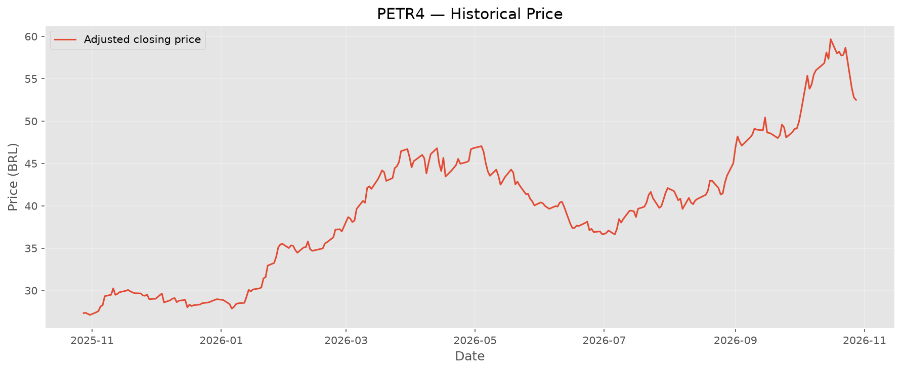
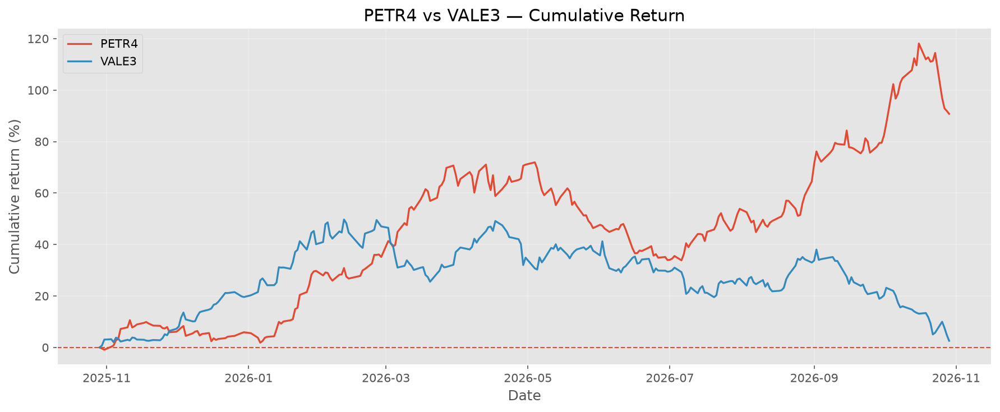

# B3 Analytics

A financial data analysis project using Python and Excel to collect, process, analyze, and visualize historical stock market data from the Brazilian Stock Exchange (B3).

## Project Overview

B3 Analytics aims to build a financial data analysis workflow using Python for data collection and processing, and Excel for data exploration and visualization.

The project focuses on historical stock performance, financial indicators, comparative analysis, and dashboard development.

## Technologies

- Python
- pandas
- yfinance
- XlsxWriter
- Microsoft Excel

## Visualizations & Dashboard

This section will showcase the charts and dashboard developed throughout the project.

### Stock Performance

Historical stock price performance over the selected analysis period.



### Returns Comparison

Comparison of cumulative returns across selected stocks and the Ibovespa index.



### Excel Dashboard

An overview of the financial indicators, charts, and comparative analysis available in the Excel dashboard.


> Note: Visualizations will be added as the project develops.

## Requirements

- Python 3
- Internet connection to retrieve historical market data
- Microsoft Excel or another compatible spreadsheet application

## Installation

### 1. Clone the repository

```bash
git clone <REPOSITORY_URL>
cd b3-analytics
```

Replace `<REPOSITORY_URL>` with the URL of your GitHub repository.

### 2. Create a virtual environment

```powershell
py -m venv .venv
```

### 3. Activate the virtual environment

On Windows, using PowerShell:

```powershell
.\.venv\Scripts\Activate.ps1
```

If PowerShell blocks script execution, temporarily allow script execution for the current session:

```powershell
Set-ExecutionPolicy -Scope Process -ExecutionPolicy Bypass
```

Then activate the environment again:

```powershell
.\.venv\Scripts\Activate.ps1
```

This setting applies only to the current PowerShell process. Organization-enforced security policies may still restrict script execution.

### 4. Install dependencies

With the virtual environment activated:

```bash
python -m pip install -r requirements.txt
```

### 5. Run the project

```bash
python main.py
```

The current script retrieves historical data for PETR4 and exports the results to:

```text
data/petr4_historico.xlsx
```

The output directory and Excel file are generated locally when the script runs.

## Project Structure

```text
b3-analytics/
├── .venv/                  # Local virtual environment (not tracked)
├── data/                   # Generated datasets and Excel files
├── docs/
│   └── images/              # README screenshots and chart exports
├── main.py                  # Main Python script
├── requirements.txt         # Python dependencies
├── .gitignore               # Git exclusion rules
└── README.md                # Project documentation
```

## Data Sources and Limitations

Historical stock market data is retrieved through the `yfinance` Python library, which accesses data made available by Yahoo Finance.

Data availability, historical coverage, and quality depend on the provider. Retrieved data should be validated before being used in financial analysis.

This project is intended for educational and portfolio purposes only. It does not constitute investment advice.

## License

A license will be selected in a future version.
