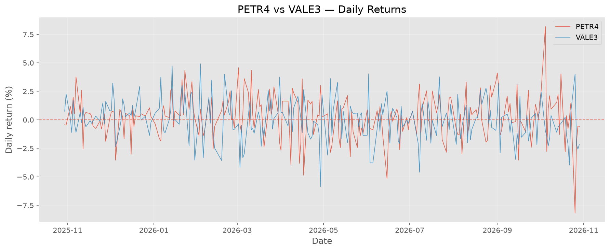
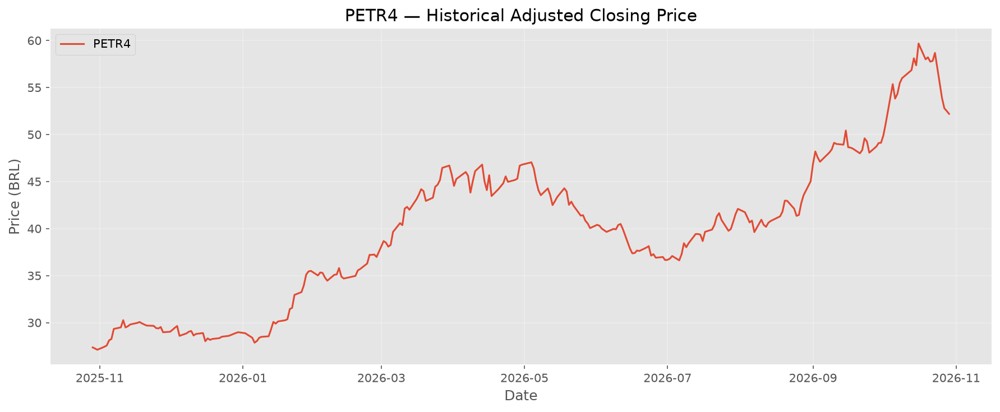
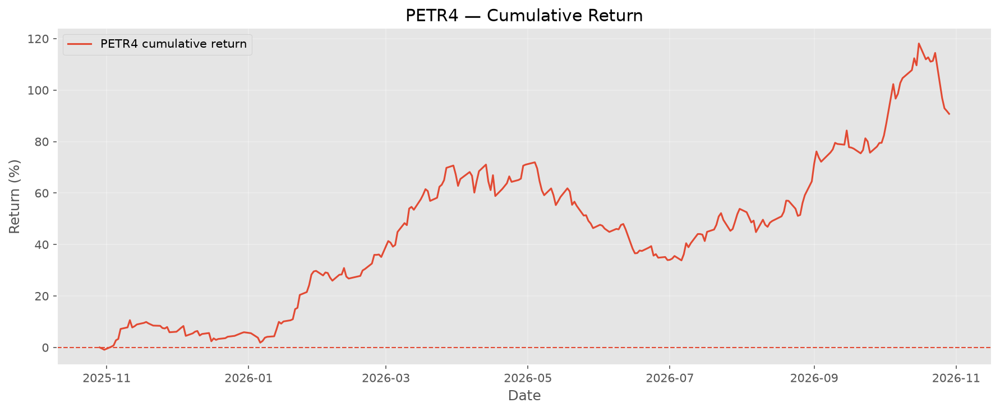
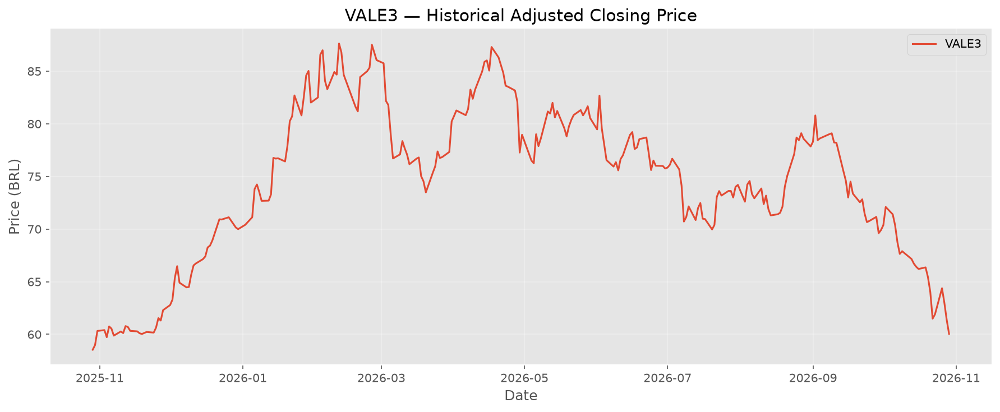
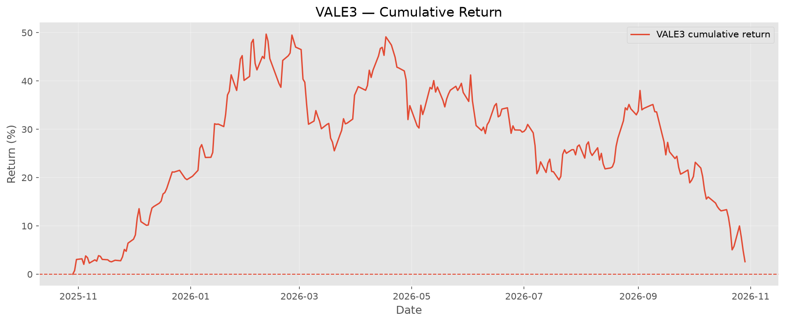

# B3 Analytics

A financial data analysis project using Python, pandas, and Excel to collect, process, analyze, and visualize historical stock market data from the Brazilian Stock Exchange (B3).

## Project Overview

B3 Analytics explores historical stock performance through data collection, financial indicators, return calculations, comparative analysis, and data visualization.

The project uses Python to retrieve and process stock market data, Jupyter Notebooks to perform exploratory analysis and generate charts, and Excel to store and explore the resulting datasets.

The current analysis focuses on **PETR4 (Petrobras)** and **VALE3 (Vale)**, comparing their historical performance and daily returns over the selected period.

## Technologies

- Python
- pandas
- yfinance
- Matplotlib
- Jupyter Notebook
- XlsxWriter
- Microsoft Excel

## Visualizations & Analysis

The charts below are generated by the Jupyter Notebook and exported to `docs/images/`.

### Stock Performance Comparison

Comparison of PETR4 and VALE3 price performance, normalized to a common starting value to make their relative performance easier to compare.


### Cumulative Returns Comparison

Comparison of cumulative returns for PETR4 and VALE3 over the selected analysis period.


### Daily Returns Comparison

Comparison of daily percentage returns to explore short-term performance fluctuations between the two stocks.



## Individual Stock Analysis

### PETR4 — Petrobras

**Stock Performance**

Historical price performance of PETR4 over the selected period.



**Cumulative Returns**

Cumulative return analysis for PETR4.



### VALE3 — Vale

**Stock Performance**

Historical price performance of VALE3 over the selected period.



**Cumulative Returns**

Cumulative return analysis for VALE3.



## Excel Dashboard

An overview of financial indicators and comparative analysis presented in an Excel dashboard.


> **Note:** The Excel dashboard image is a placeholder until `docs/images/excel-dashboard.png` is generated and added to the project.

## Requirements

- Python 3
- Internet connection to retrieve historical market data
- Microsoft Excel or another compatible spreadsheet application to open `.xlsx` files

## Installation

### 1. Clone the repository

```bash
git clone <REPOSITORY_URL>
cd b3-analytics
```

Replace `<REPOSITORY_URL>` with the URL of your GitHub repository.

### 2. Create a virtual environment

```powershell
py -m venv .venv
```

### 3. Activate the virtual environment

On Windows, using PowerShell:

```powershell
.\.venv\Scripts\Activate.ps1
```

If PowerShell blocks script execution, temporarily allow script execution for the current session:

```powershell
Set-ExecutionPolicy -Scope Process -ExecutionPolicy Bypass
```

Then activate the environment again:

```powershell
.\.venv\Scripts\Activate.ps1
```

This setting applies only to the current PowerShell process. Organization-enforced security policies may still restrict script execution.

### 4. Install dependencies

With the virtual environment activated:

```bash
python -m pip install -r requirements.txt
```

### 5. Run the data collection script

```bash
python main.py
```

The current script retrieves historical data for PETR4 & VALE3 and exports the resulting dataset to:

```text
data/petr4_hist.xlsx
data/vale3_hist.xlsx
```

The output directory and Excel file are generated locally when the script runs.

### 6. Run the Jupyter Notebook

Open the project in VS Code, select the Python interpreter from `.venv`, and open the notebook in the `notebooks/` directory.

Run the notebook cells to perform the analysis and generate the charts in `docs/images/`.

Make sure the required Excel datasets are available in the `data/` directory before running the analysis.

## Project Structure

```text
b3-analytics/
├── .venv/                          # Local virtual environment (not tracked)
├── data/                           # Generated datasets and Excel files
├── notebooks/                      # Jupyter notebooks and analysis
├── docs/
│   └── images/                     # Charts exported for the README
├── main.py                         # Main Python script
├── requirements.txt                # Python dependencies
├── .gitignore                      # Git exclusion rules
└── README.md                       # Project documentation
```

> [!IMPORTANT]
> Historical stock market data is retrieved through the `yfinance` Python library, which accesses data made available by Yahoo Finance.
> 
> Data availability, historical coverage, and quality depend on the provider. Retrieved data should be validated before being used in financial analysis.
>
> This project is intended for educational and portfolio purposes only. It does not constitute investment advice.v
